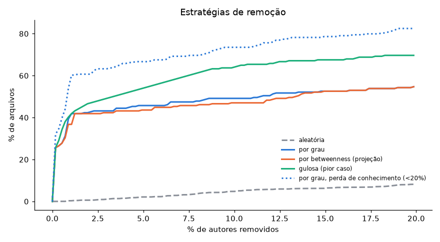
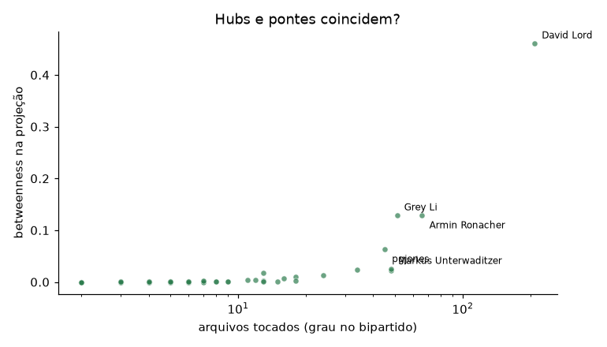
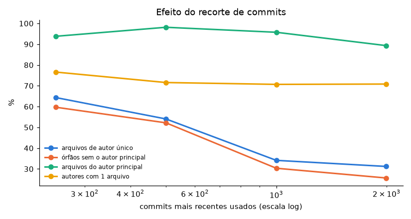
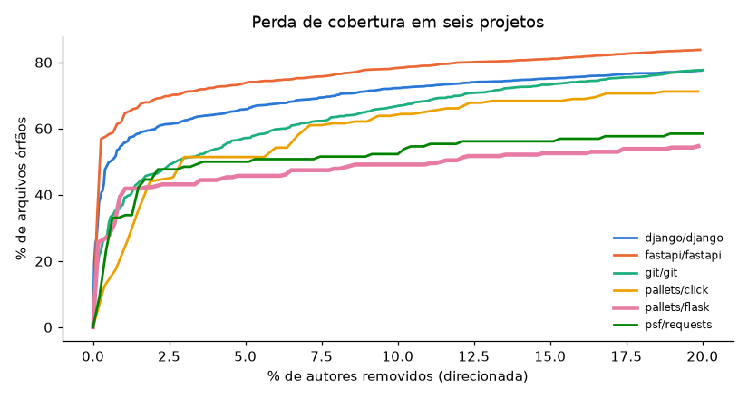

# Quem sustenta o código? Dependência de arquivos em relação a desenvolvedores em projetos open source

Projeto da Unidade 01 de **Algoritmos e Estrutura de Dados II · Grafos** (UFRN · DCA), 2026.

## Integrantes

> ⚠️ **PREENCHER antes de entregar:** nome completo de cada integrante. Sem os nomes completos aqui e no repositório, a nota não é computada.

- Nome Completo 1
- Nome Completo 2
- Nome Completo 3

## Vídeo

**Link:** https://youtu.be/LkElOkSsVVQ

---

## Problema e pergunta

Projetos open source sustentam boa parte da infraestrutura de software do mundo, mas o conhecimento sobre cada arquivo costuma estar concentrado em poucas pessoas. Quando essas pessoas saem (troca de emprego, cansaço, falta de financiamento), partes do código ficam sem ninguém que as conheça. Na literatura de engenharia de software, esse risco é chamado de *bus factor* ou *truck factor*.

**Pergunta:** *quais arquivos dependem de poucos desenvolvedores, quanto do projeto fica sem ninguém que o conheça se os desenvolvedores mais conectados saírem (em comparação com saídas ao acaso), e quem poderia assumir?*

**Quem se beneficia:** mantenedores, que precisam decidir onde investir em revisão, documentação e mentoria; e empresas e organizações que dependem do projeto e querem avaliar o risco de adotá-lo ou financiá-lo.

**Por que é uma pergunta de rede:** contagens isoladas não respondem. Dois arquivos com 70 commits podem ter riscos opostos: um com 7 autores que se revezam, outro com um único dono. O que importa é a **estrutura das ligações** entre pessoas e arquivos: quem é o único elo de um arquivo, quem liga grupos que não se falam, se existe um núcleo de pessoas que conhece o projeto todo e se esse núcleo ainda está ativo. Cada uma dessas perguntas corresponde a uma medida do curso.

O estudo aprofundado é o **Flask** (`pallets/flask`), um framework web Python maduro e muito usado. O mesmo método foi aplicado a outros cinco projetos para comparação.

## Dados (fonte, como obter, limpeza)

**Fonte:** o histórico Git público de cada repositório no GitHub. É um dado real, completo e auditável: cada commit tem autor, e-mail, data e lista de arquivos alterados.

**Como obter:** não é preciso baixar nada à mão. O `analise.py` faz um clone só de metadados (`git clone --filter=blob:none --no-checkout`), lê o histórico com
`git log --no-merges --name-only --pretty=format:@@%H%x1f%an%x1f%ae%x1f%at` e apaga o clone. O notebook faz o mesmo para o Flask. Os resultados de seis projetos já estão salvos em [`projetos/`](projetos/).

**Limpeza** (cada passo muda a rede, então todos estão registrados):

| passo | decisão | por quê | efeito no Flask |
|---|---|---|---|
| merges | descartados (`--no-merges`) | um merge não representa autoria de conteúdo | 3.828 commits lidos |
| bots | removidos por regex em nome e e-mail (`dependabot`, `pre-commit-ci`, `[bot]`, `imgbot`, nomes terminados em `-bot`…) | um bot não é alguém que conhece o código | 230 registros removidos |
| identidade | cada e-mail é mapeado para o nome mais frequente associado a ele | a mesma pessoa aparece com grafias diferentes | 854 nomes → 833 autores |
| arquivos | só os que existem no `HEAD` | a pergunta é sobre o código de hoje | — |
| ruído | `CHANGES.rst`, `CHANGELOG*`, lockfiles e `requirements/*.txt` excluídos | todos tocam esses arquivos, que não indicam conhecimento do código | 5.018 registros removidos (junto com o passo anterior) |
| resultado | **569 autores, 234 arquivos, 1.527 ligações** | | |

O funil de cada projeto aparece no app, em *Painel → Como os dados foram preparados*.

## Modelagem (nó, aresta, peso, direção, o que ficou de fora)

### Modelo principal: grafo bipartido autor–arquivo

| elemento | definição | justificativa |
|---|---|---|
| **Nó tipo A** | autor (pessoa, após unificação de identidade) | quem detém conhecimento |
| **Nó tipo F** | arquivo existente no `HEAD` | a unidade de código que precisa de alguém que a conheça |
| **Aresta** | o autor alterou o arquivo em pelo menos um commit | é a evidência observável de contato com o código |
| **Peso** | número de commits do autor naquele arquivo | distingue quem mexeu uma vez de quem é dono; é a base da "fatia dominante" e da perda ponderada |
| **Direção** | não há | "alterou" é uma relação simétrica para a pergunta (quem toca em quê); não há fluxo entre autor e arquivo |
| **Atributos** | autor: data do último commit e *ativo* (commit nos últimos 730 dias); arquivo: pasta | permitem a análise temporal e as subredes por pasta |
| **Tipo** | bipartido, simples, ponderado, não dirigido | |

### Modelos derivados (projeções)

| rede | nós | aresta | peso | serve para |
|---|---|---|---|---|
| **autor–autor** (`MᵀM`) | autores | dividem pelo menos 2 arquivos (esqueleto por limiar) | nº de arquivos em comum, com Jaccard como atributo | centralidades, núcleo, eficiência, sucessores |
| **arquivo–arquivo** (`MMᵀ`) | arquivos com ≥ 2 autores | Jaccard dos conjuntos de autores ≥ 0,3 | Jaccard | módulos de conhecimento |

### Alternativas consideradas

- **Grafo dirigido autor → arquivo:** não acrescenta informação, porque toda aresta teria o mesmo sentido.
- **Projeção autor–autor sem limiar:** um arquivo com *n* autores vira um clique de *n(n−1)/2* arestas. No Flask isso gera 12.119 pares, e 90% deles somem quando se exige 2 arquivos em comum (seção 7.2 do notebook). Usamos o esqueleto.
- **Rede temporal (janelas deslizantes):** seria o modelo ideal para ver *quando* o núcleo se dissolveu. Usamos uma versão simplificada: um atributo *ativo* por autor (seção 7.8).
- **Rede multicamada (autoria + revisão de PR):** capturaria quem revisa sem escrever. Exige a API do GitHub e fica como próximo passo.

### O que ficou de fora e por quê

- **Revisores de pull request:** não estão no histórico Git. Isso tende a superestimar a concentração no mantenedor.
- **Linhas alteradas e qualidade da mudança:** commit é a unidade. Um commit de formatação pesa como um refactor.
- **Arquivos removidos e renomeações:** a pergunta é sobre o código atual, e sem `--follow` arquivos renomeados perdem o histórico anterior.
- **Arquivos de ruído e bots:** ver Limpeza.

## Conteúdo do curso utilizado

Arquivos: [`analise_dependencia_arquivos.ipynb`](analise_dependencia_arquivos.ipynb) (notebook, análise do Flask com todas as figuras), [`analise.py`](analise.py) (funções compartilhadas com o app) e [`app.py`](app.py) (aplicação Streamlit, aba **Análises da rede**).

| conceito | semana | onde aparece | para que serviu |
|---|---|---|---|
| tipos de grafo: bipartido, ponderado, não dirigido | 2 | notebook §2 e §4 · `analise.py: analisar()` | modelar autores e arquivos como duas classes de nós |
| atributos de nó | 2 | notebook §7.8 · `analise.py: metricas_temporais()` | marcar autores ativos e achar arquivos que já estão órfãos hoje |
| densidade | 2 | notebook §4 e §7.10 · `analisar()`, `subredes_por_pasta()` | mostrar que a rede é esparsa (1,1%) e comparar pastas |
| grau, grau ponderado (força) e distribuição de grau | 2 | notebook §5.1 · `analisar()` · app: *Painel* e CCDF em *Análises da rede* | cauda longa: 70,8% dos autores tocam 1 arquivo, 31,2% dos arquivos têm 1 autor |
| subredes (subgrafo induzido) | 2 | notebook §7.10 · `subredes_por_pasta()` | localizar o risco: `.github`, `examples` e configuração dependem de uma pessoa; `src/flask` não |
| matriz de adjacência / incidência | 2 e 6 | notebook §5.2 · `matriz_incidencia()` | base das projeções `MMᵀ` e `MᵀM` e da simulação de remoção |
| efeito da amostragem na estrutura | 3 | notebook §7.11 · `efeito_amostragem()` | mostrar que ler só commits recentes dobra a concentração estimada |
| núcleo e periferia | 3 e 5 | notebook §5.5 e §7.4 | separar mantenedores de contribuidores ocasionais |
| componentes conexos (GCC) | 4 | notebook §5.3 e §7 · `app.py: simular()` | medir fragmentação antes e depois das saídas |
| caminhos, distância média e diâmetro | 4 | notebook §7.1 | testar se o autor principal é ponte (a rede se parte) ou dono (os arquivos ficam órfãos) |
| eficiência global | 4 | notebook §7.5 · `eficiencia()` | medir quanto os caminhos se alongam sem as pessoas centrais (−14% sem o principal) |
| triângulos e clustering | 4 | notebook §7.3 · `metricas_projecao()` | mostrar a estrela em torno do mantenedor (clustering 0,08) |
| centralidade de grau | 4 | notebook §5.4 e §7.3 | alcance direto do autor |
| betweenness | 4 | notebook §5.4, §7.3 e §7.6 · `metricas_projecao()` | identificar pontes e testar se elas são as donas (não são) |
| eigenvector | 4 | notebook §7.3 · `metricas_projecao()` | núcleo de decisão (ligado a outros bem ligados) |
| closeness | 4 | notebook §7.3 · `metricas_projecao()` | quem está a poucos passos de todos (0,99 para o principal) |
| robustez: remoção aleatória × direcionada × gulosa | 4 | notebook §7 e §7.6 · `curvas_remocao()` · app: *Simulação de remoção* | **resposta à pergunta**: quantas saídas deixam o projeto órfão |
| k-core, core number, degeneracy, onion layers | 5 | notebook §5.5 e §7.4 · `metricas_projecao()` | núcleo duro de 19 autores, dos quais só 1 está ativo |
| k-truss | 5 | notebook §7.4 · `truss_max()` | confirmar que o núcleo é uma equipe coesa (k-truss máximo = mesmos 19) |
| redes bipartidas e projeção | 6 | notebook §6.1 e §7.2 · `projecao_autores()` | rede de arquivos (módulos) e rede de autores (colaboração) |
| similaridade de Jaccard | 6 | notebook §6.1 e §7.7 · `projecao_autores()`, `sucessores()` | peso da projeção e **sucessor** de cada autor crítico |
| esqueleto por limiar | 6 | notebook §6.1 e §7.2 · `projecao_autores()` | remover o artefato de projeção (cliques de arquivos populares) |
| comunidades (modularidade) | fora do curso | notebook §6.1 | módulos de conhecimento (complementar) |

## Como executar

Tutorial passo a passo para reproduzir tudo numa máquina nova. Tempo total: cerca de 10 minutos, quase todo na instalação das dependências.
Testado no **Windows 11 com Python 3.12 e 3.14**, partindo de uma pasta vazia. Para Linux e macOS, os comandos equivalentes estão indicados em cada passo.

### Passo 1. Pré-requisitos

| programa | versão | onde baixar | como conferir |
|---|---|---|---|
| Python | 3.12 ou mais recente | https://www.python.org/downloads/ (no Windows, marque **"Add python.exe to PATH"** no instalador) | `python --version` (Windows: `py --version`) |
| Git | qualquer versão recente | https://git-scm.com/downloads | `git --version` |

Também é preciso internet: o notebook baixa o histórico do Flask (cerca de 15 MB) e o `pip` baixa as bibliotecas.

### Passo 2. Baixar o projeto

```bash
git clone https://github.com/guilhermedantass/study-opensource-projects-grafos.git
cd study-opensource-projects-grafos
```

> **Windows:** clone numa pasta de caminho curto, como `C:\aed2`. Dentro de pastas muito profundas, o limite de tamanho de caminho do Windows impede uma das bibliotecas (`pyarrow`) de carregar.

### Passo 3. Criar o ambiente e instalar as dependências

**Windows (PowerShell):**

```powershell
py -m venv .venv
.venv\Scripts\Activate.ps1
python -m pip install -r requirements.txt
```

**Linux / macOS:**

```bash
python3 -m venv .venv
source .venv/bin/activate
python -m pip install -r requirements.txt
```

Ao ativar o ambiente, `(.venv)` aparece no começo da linha do terminal. Todas as versões estão fixadas no [`requirements.txt`](requirements.txt). A instalação leva de 3 a 6 minutos.

### Passo 4. Reproduzir a análise completa (um comando)

```bash
jupyter nbconvert --to notebook --execute --inplace analise_dependencia_arquivos.ipynb
```

Esse comando faz, em menos de 1 minuto:

1. clona o Flask em `repos/flask` e fixa o repositório no commit `d086db8`, a mesma versão analisada, para os números saírem **idênticos** aos deste README;
2. executa todas as células do notebook: limpeza, rede, métricas, simulações e comparação;
3. gera de novo todas as figuras em [`figuras/`](figuras/) e os CSVs em [`data/`](data/), sobrescrevendo os que vieram no repositório.

Para acompanhar célula por célula, abra o notebook de forma interativa com `jupyter lab` (ou no VS Code, escolhendo o kernel do `.venv`) e use **Run All**.

### Passo 5. Abrir a aplicação interativa

```bash
streamlit run app.py
```

O navegador abre em http://localhost:8501. Um roteiro rápido pela aplicação:

1. Na barra lateral, escolha o projeto. O **pallets/flask** já vem selecionado.
2. Na aba **Grafo bipartido**, passe o mouse sobre os nós: círculos verdes são pessoas, quadrados são arquivos e os laranja são arquivos críticos.
3. Na aba **Painel**, veja a concentração, os arquivos críticos e as curvas das estratégias de remoção.
4. Na aba **Análises da rede**, veja centralidades, núcleo (k-core), sucessores, janela temporal, subredes por pasta e efeito da amostragem.
5. Na aba **Simulação de remoção**, escolha **David Lord** e veja os arquivos órfãos. Depois marque *"Remover também todos os autores inativos"*.
6. Na aba **Comparar projetos**, veja os seis projetos lado a lado.

Para encerrar, use `Ctrl+C` no terminal.

### Passo 6 (opcional). Analisar outros repositórios

```bash
python analise.py pallets/click                                    # qualquer repositório público do GitHub
python analise.py https://github.com/django/django --max-commits 15000
python preparar_padrao.py                                          # refaz os seis projetos de comparação (~25 min)
```

O mesmo pode ser feito pela barra lateral da aplicação, em *Analisar outro projeto*. Esses comandos leem a versão **atual** de cada repositório. Por isso, os números podem diferir dos salvos em [`projetos/`](projetos/), coletados em 16/10/2026: a data e o commit analisado estão no `resumo.json` de cada projeto.

### Problemas comuns

| sintoma | solução |
|---|---|
| `python` não é reconhecido | No Windows, use `py` no lugar de `python`; no Linux/macOS, `python3`. Ou reinstale o Python marcando "Add python.exe to PATH". |
| `Activate.ps1 não pode ser carregado` (PowerShell) | Rode `Set-ExecutionPolicy -Scope Process -ExecutionPolicy Bypass` e ative de novo. Ou use o Prompt de Comando com `.venv\Scripts\activate.bat`. |
| `DLL load failed ... O nome do arquivo ou a extensão é muito grande` | O caminho da pasta é longo demais. Clone o projeto em `C:\aed2` e refaça o passo 3. |
| `git` não é reconhecido | Instale o Git (passo 1) e abra um terminal novo. |
| `ReadTimeoutError` durante o `pip install` | A rede está lenta. Rode `python -m pip install --timeout 120 -r requirements.txt`. |
| `Port 8501 is already in use` | Rode `streamlit run app.py --server.port 8502`. |
| A primeira célula do notebook demora | Ela está clonando o Flask. Na segunda execução, o clone é reaproveitado. |

### Estrutura

```
analise_dependencia_arquivos.ipynb   análise do Flask, passo a passo, com interpretação
analise.py                           coleta, limpeza e todas as métricas (usado pelo app e pelo notebook)
app.py                               aplicação Streamlit
preparar_padrao.py                   gera os projetos de comparação
projetos/<dono>__<repo>/             resultados salvos por projeto (CSVs + resumo.json)
figuras/                             figuras geradas pelo notebook
data/                                CSVs gerados pelo notebook
requirements.txt                     dependências com versões fixadas
```

## Resultados

### Flask: a resposta



| cenário | órfãos (remoção por grau) | órfãos (remoção aleatória) | razão |
|---|---|---|---|
| 1 autor (o mais conectado) | 25,6% | 0,05%* | ~470× |
| 1% dos autores (6) | 41,9% | 0,3% | ~130× |
| 5% dos autores (28) | 45,7% | 2,1% | ~22× |
| 20% dos autores (113) | 54,7% | 8,2% | ~7× |

\* Para 1 autor, o valor é o esperado exato: 73 arquivos de autor único ÷ 569 autores ÷ 234 arquivos. A média de 200 sorteios (0,01%) é instável com um único autor removido.

**1. Quais arquivos dependem de poucos desenvolvedores?** 31,2% dos arquivos têm um único autor. Dos 156 arquivos com pelo menos 3 commits, 33 (21%) têm um autor com 80% ou mais dos commits, e **os 33 têm o mesmo dono, David Lord**. Esse número depende dos limiares (varia de 10% a 56% nas 16 combinações testadas), mas a conclusão não: ele é o dono mais frequente em todas. Por pasta, o risco de exclusividade está na **infraestrutura**: `.github` (67% dos arquivos só dele), `examples` (62%) e configuração da raiz (43%). O código em `src/flask` é compartilhado (3,8% ficariam órfãos sem ele).

**2. Quanto fica órfão se os mais conectados saírem?** Sem **uma** pessoa, 25,6% dos arquivos ficam sem nenhum autor. Ao acaso, o esperado seria 0,05%. A ordem de saída importa muito:
- pela ordem de **grau**, 65 autores levam a 50% de órfãos;
- pela **remoção gulosa** (a cada passo sai quem mais deixaria órfãos), bastam **19**. O *truck factor* real é muito menor do que o ranking por grau sugere;
- pela **betweenness**, são 76. **Pontes não são donas**: a betweenness responde a outra pergunta (por onde o conhecimento circula), e removê-las derruba a eficiência da rede de colaboração em 44% com 5 pessoas;
- na **definição ponderada** (quem ficou tem menos de 20% dos commits), 1 saída já afeta 32% dos arquivos e **5 saídas afetam metade**.

**3. A rede se parte?** Não. Sem o autor principal, a GCC mantém 97% dos nós e a distância média sobe de 3,41 para 3,84. O risco é de **cobertura de conhecimento**, não de fragmentação. Na projeção autor–autor ele é o centro de uma **estrela**: divide código com 162 dos 163 colegas (closeness 0,99), mas esses colegas quase não trabalham entre si (clustering 0,08). Hubs e pontes são as mesmas pessoas (Spearman 0,88; 9 dos 10 primeiros coincidem).



**4. Existe um grupo que conhece o projeto?** Existiu. O k-core máximo da projeção (degeneracy 16) tem 19 autores, e o k-truss máximo seleciona os mesmos 19: uma equipe coesa. Mas **só 1 dos 19 está ativo**. Considerando só quem fez commits nos últimos dois anos (22 de 569 autores), **10,7% dos arquivos já estão órfãos hoje** e **76,9% dependem de uma única pessoa ativa**.

**5. Quem poderia assumir?** Ninguém está pronto. O sucessor por Jaccard (Armin Ronacher, J = 0,27) está inativo desde 2020 e alterou só 1 dos 33 arquivos críticos. Quem mais cobre os críticos (pgjones, 27%) também está inativo. **Recomendação:** parear um segundo mantenedor nos arquivos de CI, release e configuração, que é onde a exclusividade é total.

**Cuidado com a amostragem.** Refazendo a rede só com os commits recentes, a concentração estimada **dobra** (64% de arquivos de autor único com os 250 últimos commits contra 31% no histórico completo). Isso afeta a comparação abaixo para o `django`, o único analisado com recorte (15.000 commits).



### Comparação entre projetos

| projeto | commits lidos | autores | arquivos | arquivos do autor principal | arquivos de autor único | órfãos sem o autor principal | órfãos sem 1 autor ao acaso | autores p/ 50% de órfãos (grau / gulosa) | núcleo (k-core máx.) | autores ativos | arquivos sem autor ativo |
|---|---|---|---|---|---|---|---|---|---|---|---|
| fastapi/fastapi | 7.806 | 763 | 3.169 | 91,8% | 40,0% | 32,2% | 0,00% | 2 / 2 | 24 | 213 | 1,1% |
| pallets/flask | 3.828 | 569 | 234 | 89,3% | 31,2% | 25,6% | 0,01% | 65 / 19 | 19 | 22 | 10,7% |
| django/django¹ | 15.000 | 2.539 | 6.274 | 62,1% | 35,2% | 19,3% | 0,00% | 15 / 12 | 156 | 376 | 8,7% |
| pallets/click | 2.171 | 267 | 177 | 52,0% | 38,4% | 12,4% | 0,10% | 8 / 6 | 32 | 84 | 9,0% |
| psf/requests | 4.862 | 470 | 130 | 59,2% | 28,5% | 9,2% | 0,25% | 17 / 8 | 29 | 38 | 14,6% |
| git/git | 61.148 | 1.935 | 4.753 | 39,7% | 39,2% | 3,1% | 0,01% | 53 / 42 | 191 | 312 | 10,5% |

¹ Só os 15.000 commits mais recentes. 1.379 dos seus 1.409 arquivos críticos são traduções (`locale/`), atualizadas em lote por um mantenedor na sincronização das traduções: um artefato do fluxo de trabalho, não do conhecimento do código.



**Leitura.** O padrão se repete nos seis projetos: sem só o autor principal, de 3,1% a 32,2% dos arquivos ficam órfãos, contra no máximo 0,25% ao acaso. A remoção gulosa sempre precisa de menos gente que a ordem por grau. O `fastapi` é o mais concentrado (2 pessoas deixam metade dos arquivos órfãos) e o `git` o mais distribuído (núcleo de 191 autores). O traço que distingue o Flask é a base ativa: 22 autores ativos e um núcleo histórico de 19, dos quais só 1 continua. A ordem entre projetos depende das escolhas do estudo (filtros, limiares, recorte) e serve para mostrar que o fenômeno é geral, não para ranquear projetos.

## Limitações e próximos passos

- **Commit não é conhecimento.** A aresta prova contato com o arquivo, não entendimento. A versão ponderada atenua isso, mas a unidade continua sendo o commit.
- **Revisores ficam de fora.** Com *squash merge*, quem revisa e aprova não aparece, o que superestima a concentração no mantenedor.
- **Identidade heurística.** A mesma pessoa com dois e-mails vira duas, o que dilui a concentração e deixa o resultado otimista.
- **Renomeações.** Sem `--follow`, arquivos movidos perdem o histórico, o que subestima o número de autores.
- **Escolhas de limiar.** O esqueleto (≥ 2 arquivos), o arquivo crítico (80% / 3 commits), a perda ponderada (20%) e a janela de atividade (730 dias) são escolhas. O notebook mostra o efeito de cada uma (§7.2, §7.9) e as conclusões principais se mantêm.
- **Aproximações.** A betweenness e a eficiência usam 300 origens sorteadas. A gulosa é míope: aproxima o pior caso, mas não o garante.
- **Topologia não é importância.** Um arquivo órfão em `tests/templates` vale menos que um em `src/flask`. As subredes por pasta atenuam isso, mas sem dados de uso o modelo mede estrutura, não impacto.
- **Amostragem.** Recortes de commits recentes inflam a concentração (§7.11).

**Próximos passos:** (1) incluir revisores via API do GitHub e montar uma rede multicamada autoria + revisão; (2) usar linhas alteradas como peso; (3) seguir renomeações; (4) janelas deslizantes para datar a dissolução do núcleo; (5) validar o *truck factor* da gulosa contra o algoritmo de Avelino et al. (2016).

## Referências

- Avelino, G.; Passos, L.; Hora, A.; Valente, M. T. *A novel approach for estimating truck factors*. IEEE International Conference on Program Comprehension (ICPC), 2016.
- Albert, R.; Jeong, H.; Barabási, A.-L. *Error and attack tolerance of complex networks*. Nature 406, 2000.
- Latora, V.; Marchiori, M. *Efficient behavior of small-world networks*. Physical Review Letters 87, 2001.
- Seidman, S. B. *Network structure and minimum degree*. Social Networks 5, 1983.
- Cohen, J. *Trusses: cohesive subgraphs for social network analysis*. National Security Agency Technical Report, 2008.
- Newman, M. *Networks*. 2ª ed. Oxford University Press, 2018.
- Hagberg, A.; Schult, D.; Swart, P. *Exploring network structure, dynamics, and function using NetworkX*. Proceedings of the 7th Python in Science Conference (SciPy), 2008.
- Material da disciplina Algoritmos e Estrutura de Dados II (Grafos), semanas 2 a 6, Prof. Ivanovitch Silva, UFRN/DCA, 2026.
